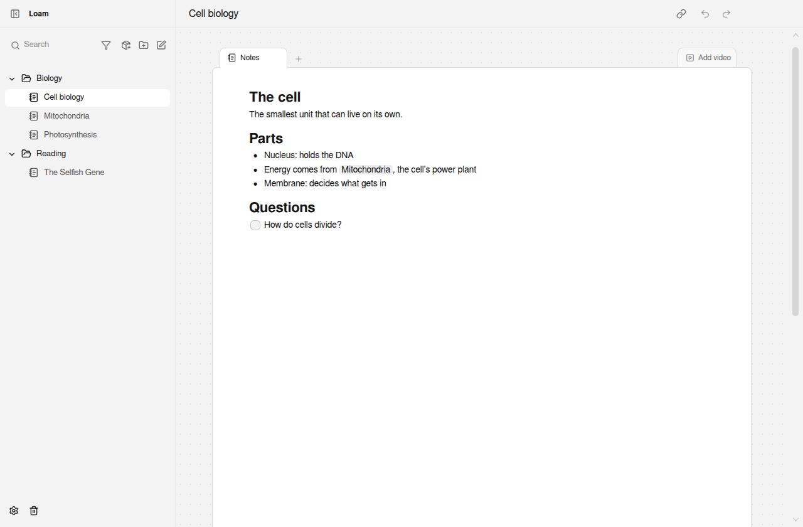

# Loam

A free, open-source, local-first notes app with linked notes, diagrams and
video study. No account, no server: your notes live on your machine.

Loam is a desktop app (Electron). There is no mobile app yet.



## Features

- Block editor with headings, lists, checklists, tables, columns and images.
- Link notes to each other with `@` mentions; every note shows its backlinks.
- Diagram canvas inside any note: shapes, labeled connections and frames. Import
  Mermaid or JSON Canvas; export PNG, SVG or JSON Canvas.
- Table tabs with typed columns.
- Study YouTube videos next to your notes, with timestamp links that jump the video.
- PDF, Word and Markdown tabs: read PDFs (find, zoom, and the page you were on)
  and Word documents, and edit Markdown as Markdown. Copy a file into your notes,
  or keep it as a reference where it is: open any of these files with Ctrl+O,
  by dropping it on the window or with "Open with", and Loam links to it.
  Show a file beside the note to read it while you write.
- Full-text search across titles and note bodies.
- Folders, and saves that survive quitting or a crash mid-edit.
- Stores everything in a single SQLite file by default, or in a storage backend you plug in.
- Import a folder of Markdown files or an Obsidian vault: subfolders become
  folders, `[[wikilinks]]` (with aliases and headings) become note links, `.canvas`
  files become diagrams and local images are copied in. Evernote `.enex` notebooks
  come in with their images, checklists and code blocks, and Notion `.zip` exports
  keep their page tree, links and images, with databases as table tabs. HTML pages
  (from Apple Notes exporters or "save as web page") bring their images too.
  Existing notes are never changed by an import.
- Export every note, or a single one, as Markdown that Obsidian opens as a vault:
  folders stay folders, links become `[[wikilinks]]`, diagrams also get a `.canvas`
  file and images are copied alongside.
- Version history for every note: right-click a note › Version history to see and
  restore the content it had before each editing session (kept for 30 days).
- Daily backups you can restore from Settings, including before every import.
- Sync between your computers through a folder Dropbox, iCloud Drive, OneDrive or
  Syncthing already syncs (Settings › Sync). It runs in the background and works
  offline; a note edited on two computers at once keeps both versions. Your
  notes never pass through an Loam server.
- Optional encryption with a passphrase and a recovery key (Settings › Security):
  notes, images, backups and the files in your sync folder are encrypted, and
  Loam asks for the passphrase each time it starts.
- Settings (`Ctrl+,` or `Cmd+,`) show where your data lives.

## Download

Windows installers are on the [Releases](https://github.com/ramon427/loam/releases) page; installed copies
update themselves. The installer isn't signed yet, so Windows SmartScreen warns
on first run. On macOS and Linux, build from source.

## Build from source

You need Node.js 24 (see `.nvmrc`).

```sh
npm install
npm run dev      # the app with hot reload
npm start        # a production build of the app
```

[CONTRIBUTING](CONTRIBUTING.md) lists every script and the checks a change
must pass; [docs/architecture.md](docs/architecture.md) explains how the app is
built.

## Side chat

An optional AI assistant in a panel beside your notes: ask it anything, and it
can search the web, use a browser, and read, write and organize your notes. It
is off by default; turn it on in **Settings › Side chat**, then open it with
**Ctrl+Shift+J** (**Cmd+Shift+J** on macOS).

- **Bring your own model:** an Anthropic or OpenAI API key, any
  OpenAI-compatible service (OpenRouter, Ollama, LM Studio), or the Claude Code
  or Codex CLI you already have installed and signed in to. CLI support is
  experimental; whether your subscription may be used this way is up to its
  terms.
- **The web:** web search and page reading (with Anthropic and the CLIs, their
  own; with OpenAI-style APIs, Loam's page reader), and Loam's browser window, which
  you can watch as the assistant opens pages, clicks and types. Its sign-ins
  stay apart from the app.
- **Your computer:** with a CLI provider, the assistant can also read your
  files and run commands, as the access mode allows.
- **Access modes:** _Supervised_ asks before any change, _Auto-accept edits_
  edits notes freely and asks before creating, moving, deleting or acting
  outside Loam (clicks, typing, commands), and _Full access_ never asks. _Plan_
  mode only reads and proposes. Every action shows in the chat; note changes
  can be undone.

Keys are encrypted by your operating system and stay on this computer. Chats
are kept beside your notes, encrypted when your notes are, and are not synced
or backed up.

## Plugins

Plugins add commands, slash menu items, panes and drawings in the note header
or sidebar. Each runs in a worker of its own with no DOM, no Node and no
network beyond the hosts its manifest names, and asks for its permissions when
you switch it on (Settings › Plugins). Three small examples, and how to build
and install them, are in [examples/plugins](examples/plugins/README.md); the
API's types are in [packages/plugin-api](packages/plugin-api/index.d.ts).

## AI access (MCP)

AI clients can use Loam through its built-in Model Context Protocol server.
It operates on the running app's library through the same validated operations as
the desktop UI, including history, backups, encryption and sync.

1. Open **Settings › AI access** and click **Enable AI access**.
2. Click **Copy HTTP configuration** and paste it into your client's MCP server
   configuration. The endpoint is `http://127.0.0.1:47821/mcp` by default; Settings
   lets you choose another port if it is already in use.
3. For clients that launch an MCP process, use **Copy stdio configuration**.
   The app includes a stdio connector that forwards requests to the running app.
4. Keep Loam open. Turn AI access off to disconnect clients, or replace the
   connection key to revoke an old HTTP configuration.

Access starts off and remembers your choice. The local server requires a bearer
connection key and accepts connections only on this computer. The configuration
copied from Settings includes that key, so share it only with clients you authorize.
Access settings and keys live outside note backups and sync. An encrypted library
stays locked for AI clients until it is unlocked.

The tool catalog covers:

- Notes: list, read, create, edit, rename, delete, restore, search and backlinks.
- Folders and placement: create, rename, remove, reorder and move notes.
- Content: all text blocks and formatting, headings, links, checklists, images,
  columns, text/diagram/table tabs, graph shapes and connections, frames, heading
  connections, live graph snapshots, typed table columns and rows, study videos
  and timestamp links.
- Transfer: Markdown/Obsidian, Evernote, Notion and HTML imports, complete vault
  exports, and Mermaid/JSON Canvas diagram imports and exports plus SVG/PNG.
- History, backup creation and restore, sync setup and control, encryption and
  recovery, app information and update management.
- Workspace: open notes/tabs, inspect the current workspace, save pending edits,
  change the app theme and open, play, pause or seek a study video. Diagram templates
  and the app's automatic layouts are also available.

Start with `loam_notes_library` and `loam_notes_get`. Reads save pending editor changes
first. Updates require the `updatedAt` from the last read as `baseUpdatedAt`; stale
AI updates fail with `CONFLICT` so the client can reread before retrying. User edits
made concurrently with an AI update retain the AI content as a conflict copy.
Convenience tools such as `loam_notes_new`, `loam_tabs_add`, `loam_blocks_set`,
`loam_graphs_set`, `loam_tables_set` and `loam_import_run` preserve unrelated content.
`loam_notes_save` also accepts the full editor data model. Import/export paths are
absolute local paths, so AI clients can complete transfers without file dialogs.

The server publishes `loam://guide`, `loam://library` and `loam://notes/{noteId}` resources
with usage instructions and current data. Access consent and connection keys are
managed in Settings; those controls and internal window replies are excluded from
MCP. The catalog is checked against the desktop bridge at compile time and in
tests so new app operations cannot be added without an explicit MCP decision.

## Your data

Notes live on your computer, in one SQLite database in the app's data folder
(Settings shows where). Nothing is sent anywhere unless you set up sync, which
writes to a folder your cloud drive already syncs.

**Encryption** is optional (Settings › Security). With it on, every note,
image, backup and sync file is encrypted with a random key, which is locked by
your passphrase and by a recovery key shown once. **If you forget the
passphrase and lose the recovery key, your notes can't be opened again**, by
you or by anyone else. With the recovery key, "Forgot your passphrase?" at
launch sets a new one.

- Turning encryption on or off rewrites the library in place, after a backup.
  A crash part way finishes at the next launch.
- On other computers that sync the library, syncing pauses until the same
  passphrase (or the recovery key) is entered in Settings › Sync.
- Markdown exports are plain files.
- Encryption hides what notes say, not that they exist: note, folder and image
  ids, how many there are, their sizes and when they change stay visible, and
  so do edits not yet saved when the app closes, which the window keeps until
  the next launch saves them.

[SECURITY.md](SECURITY.md) describes how Loam protects your notes and how
to report a security problem.

## Performance with 10,000 notes

Measured on a virtual server (Intel Haswell, 8 cores, 23 GB RAM, Linux, Node 24)
with a generated library of 10,000 notes of 8 to 30 blocks each (paragraphs,
headings, lists, links between notes, some images) in 100 folders, stored in
SQLite. Run `npm run bench` to measure your own machine; results are written to
`tmp/bench/`.

| What                                            | Time                                    |
| ----------------------------------------------- | --------------------------------------- |
| Open the library (cold start of the store)      | 272 ms                                  |
| Launch to the note list in the app              | 1.8 s                                   |
| Open a note (store)                             | 0.3 ms median                           |
| Switch notes in the app (editor shown)          | 0.2 s median                            |
| Search as you type, in the app                  | 69–88 ms to results                     |
| Search in the store, common / rare word         | 30 ms / 3.6 ms median                   |
| Backlinks of a note                             | 3.7 ms median                           |
| Import a 10,000-file Obsidian vault, in the app | 63 s, with live progress                |
| Export everything as Markdown                   | 12.4 s                                  |
| Daily backup (24 MB file)                       | 8.3 s, saves never wait more than 12 ms |
| First sync of the library to a sync folder      | 11.6 s                                  |
| A second computer takes in the whole library    | 17.7 s                                  |
| Background sync with nothing new                | 120 ms                                  |
| Turn encryption on                              | 8.3 s                                   |
| Unlock (scrypt), then open, encrypted           | 0.6 s + 0.9 s                           |
| Search in the store, encrypted, common / rare   | 23 ms / 12 ms median                    |

The database takes about 200 MB for this library.

## License

[MIT](LICENSE). Release builds list the licenses of the packages they include
in `THIRD_PARTY_LICENSES.txt`.
