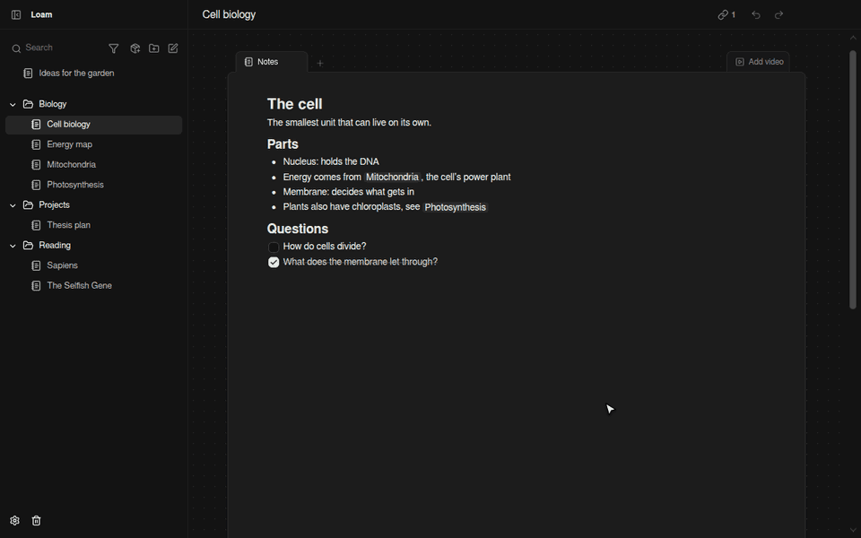

# Loam

A free, open-source, local-first notes app. Linked notes, diagrams and video
study, all on your machine. No account, no server.



## Features

- **Block editor**: headings, lists, checklists, tables, columns, images.
- **Linked notes**: `@` mentions with backlinks on every note.
- **Diagrams**: a canvas in any note, with shapes, labeled connections and
  frames. Imports Mermaid and JSON Canvas; exports PNG, SVG and JSON Canvas.
- **More tabs**: tables with typed columns, YouTube videos with timestamp
  links, PDFs, Word documents and Markdown.
- **Search** across every title and note body.
- **Import** Markdown folders, Obsidian vaults, Evernote, Notion and HTML.
  **Export** to Markdown that Obsidian opens as a vault.
- **Safe by default**: version history, daily backups, and saves that survive
  a crash.
- **Sync** through a folder Dropbox, iCloud Drive, OneDrive or Syncthing already
  syncs. No Loam server involved.
- **Optional encryption** with a passphrase and a recovery key.
- **[Side chat](docs/side-chat.md)**: an optional AI assistant (bring your own Anthropic, OpenAI or
  local model, or the Claude Code or Codex CLI). Off by default.
- **Plugins** and a built-in **[MCP server](docs/mcp.md)** for AI clients.


## Download

Windows installers and macOS disk images are on the
[Releases](https://github.com/ramon427/loam/releases) page. On Linux, build
from source.

**Windows:** the installer updates itself. It is unsigned for now, so
SmartScreen warns on first run.

**macOS:** download `Loam-<version>-arm64.dmg` for Apple silicon (M1 and
later) or `Loam-<version>-x64.dmg` for Intel, open it and drag Loam into
Applications. The app isn't notarized by Apple, so macOS blocks the first
launch. Either:

- open Loam once, then go to System Settings > Privacy & Security and click
  **Open Anyway** (on macOS 14 and earlier, Control-click Loam in Applications
  and choose **Open** instead), or
- run `xattr -dr com.apple.quarantine /Applications/Loam.app` in Terminal.

macOS installs only signed updates, so Loam on a Mac tells you when a new
version is out and links to its download; install it the same way.

## Build from source

Requires Node.js 24 (see `.nvmrc`).

```sh
npm install
npm run dev      # the app with hot reload
npm start        # a production build
```

## Your data

Notes live in one SQLite file in the app's data folder (Settings shows where).
Nothing leaves your computer unless you set up sync.

With encryption on, **if you forget the passphrase and lose the recovery key,
your notes can't be opened again**, by you or anyone else.

## Learn more

- [CONTRIBUTING](CONTRIBUTING.md): scripts and checks
- [Architecture](docs/architecture.md): how the app is built
- [AI access (MCP)](docs/mcp.md): connect AI clients to your notes
- [Plugins](examples/plugins/README.md): examples and the
  [API types](packages/plugin-api/index.d.ts)
- [Performance](docs/performance.md): numbers with 10,000 notes
- [SECURITY](SECURITY.md): how your notes are protected

## License

[MIT](LICENSE).
